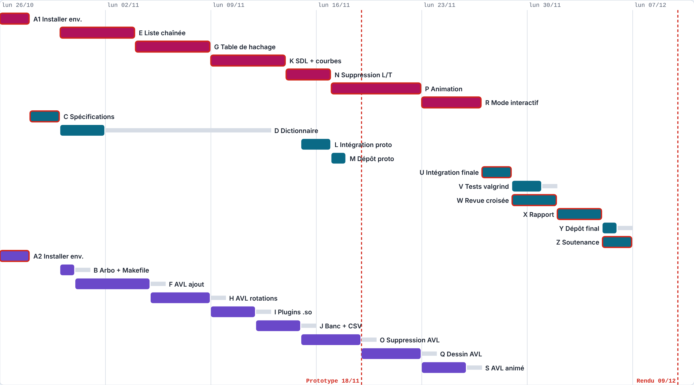

<div align="center">

# Comparateur de structures de données

**Liste chaînée · Table de hachage · Arbre AVL**

Projet final de Langage C · ESGI Paris · Bachelor 2 · Classe 2A3 · 2026-2027

Groupe 8 · Lilia Ben Salah et Javerichalle MFINA · Enseignant : Kevin Trancho

</div>

---

## Sommaire

1. [Le projet](#le-projet)
2. [Fonctionnalités](#fonctionnalités)
3. [L'équipe et la répartition](#léquipe-et-la-répartition)
4. [Planning](#planning)
5. [Installation et lancement](#installation-et-lancement)
6. [Documents du projet](#documents-du-projet)

---

## Le projet

Le programme compare les performances de **trois structures de données** écrites en langage C.

Il charge un dictionnaire de mots depuis un fichier, insère ces mots dans chacune des structures, puis **mesure le temps d'insertion et de recherche** pour des volumes croissants. Les résultats sont exportés en **CSV** et affichés sous forme de **courbes** avec la bibliothèque SDL.

| Structure | Principe | Recherche d'un mot |
|---|---|---|
| **Liste chaînée** | Les mots se suivent, chacun pointe vers le suivant | Parcours un par un, O(n) |
| **Table de hachage** | Un calcul sur le mot donne directement sa case | Accès direct en moyenne, O(1) |
| **Arbre AVL** | Arbre de recherche toujours équilibré | Descente gauche / droite, O(log n) |

> [!NOTE]
> **Objectif :** vérifier par la mesure quelle structure est la plus adaptée selon la quantité de données, et expliquer les écarts observés.

---

## Fonctionnalités

| Niveau | Fonctionnalité |
|---|---|
| **Prototype** | Chargement d'un dictionnaire de mots depuis un fichier |
| **Prototype** | Interface commune aux trois structures (créer, ajouter, chercher, supprimer, détruire) |
| **Prototype** | Chaque structure est un **plugin** `.so` chargé au lancement |
| **Prototype** | Banc de test : temps et nombre d'opérations sur des volumes croissants |
| **Prototype** | Export des mesures en CSV et affichage des courbes dans une fenêtre SDL |
| **Final** | Suppression dans les trois structures |
| **Final** | Dessin de chaque structure et **animations** des ajouts et suppressions, étape par étape |
| **Final** | **Mode interactif** : l'utilisateur ajoute, cherche ou supprime un mot et voit le résultat |

---

## L'équipe et la répartition

| | **Lilia Ben Salah** | **Javerichalle MFINA** |
|---|---|---|
| **Structures** | Arbre AVL | Liste chaînée, table de hachage |
| **Outils** | Plugins `.so`, banc de test, compteur d'opérations, export CSV | Fenêtre SDL, courbes, moteur d'animation, mode interactif |
| **En commun** | Interface commune, lecture du dictionnaire, rapport, soutenance | Idem |

> [!TIP]
> Chacune travaille sur sa propre branche et dans sa propre machine virtuelle Debian. Le travail terminé arrive dans `main` par une **Pull Request**, relue par l'autre.

---

## Planning

| Étape | Date limite | État |
|---|---|---|
| Choix du sujet | 14/10/2026 | ✅ Validé |
| Roadmap | 21/10/2026 | ✅ Rendue |
| Prototype | 18/11/2026 | 🔄 En cours |
| Rendu final | 09/12/2026 | ⏳ À venir |
| Soutenance | 10/12/2026 | ⏳ À venir |

> [!IMPORTANT]
> Le réseau PERT montre l'ordre des tâches, qui les fait, leurs dates, leurs marges et le chemin critique. Le Gantt les place dans le temps.

### Réseau PERT

**[📄 Ouvrir le réseau PERT (PDF)](docs/PERT.pdf)**

Le PDF montre, pour chaque tâche : qui la fait, ses dates au plus tôt et au plus tard, sa durée, sa marge, et ce qui doit être fini avant de la commencer. Le chemin critique est en rouge.

### Diagramme de Gantt

<a href="docs/gantt.png"></a>

---

## Installation et lancement

Le projet se compile avec **gcc sous Linux** (Debian ou Ubuntu, 64 bits).

```bash
sudo apt install build-essential git valgrind libsdl1.2-dev libsdl-gfx1.2-dev wfrench
```

Le détail de l'installation est dans **[docs/INSTALLATION.pdf](docs/INSTALLATION.pdf)**.

> [!NOTE]
> La compilation (`make`) et le lancement du programme seront détaillés avec le prototype.

---

## Documents du projet

| Document | Contenu |
|---|---|
| [docs/PERT.pdf](docs/PERT.pdf) | Réseau PERT : ordre des tâches, dates, marges, chemin critique |
| [docs/gantt.png](docs/gantt.png) | Diagramme de Gantt : les tâches dans le temps |
| [docs/INSTALLATION.pdf](docs/INSTALLATION.pdf) | Préparer l'environnement de travail |
